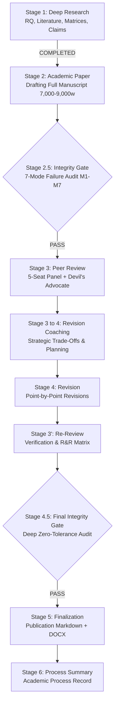

# Project Master Index: Battlefield: Bad Company 2 Academic Research Project

**Project Title:** War as Entertainment: Military Satire, Squad Identity, Destructive Gameplay, and the Spectacle of Violence in *Battlefield: Bad Company 2*  
**Repository Working Directory:** `research/battlefield-bad-company-2/`  
**Pipeline Framework:** Academic Research Skills (ARS v3.24.1, commit `2e02041a3b821a160d98c9398f173c484ac759a8`)  
**Status:** Stage 1 (`deep-research`) Active & Systematic Deployment  
**Timestamp:** 2026-11-03 15:15:00 +06:00  

---

## 1. Master Deliverables Registry

| Deliverable File | Core Contents & Analytical Scope | ARS Stage | Status |
|---|---|---|---|
| `README.md` | Workspace introduction, directory layout, environment configuration | Invariants | Complete |
| `context.md` | Research boundaries, disciplinary matrix, constraints, RQs | Invariants | Complete |
| `dev-log.md` | Chronological research and development log with timestamps | Invariants | Active / Updated |
| `CHANGELOG.md` | Semantic versioning of manuscript and analytical artifacts | Invariants | Active / Updated |
| `00_PROJECT_README.md` | Master project tracker, pipeline state machine, deliverables register | Stage 1 (`deep-research`) | Complete |
| `01_RESEARCH_BRIEF.md` | Research questions (Primary + RQ1–RQ10), methodology blueprint | Stage 1 (`deep-research`) | Complete |
| `02_SEARCH_STRATEGY_AND_LOG.md` | Search queries, databases, screening protocol, 34 included records | Stage 1 (`deep-research`) | Complete |
| `03_ANNOTATED_BIBLIOGRAPHY.md` | 34 verified peer-reviewed literature & developer primary sources | Stage 1 (`deep-research`) | Complete |
| `04_LITERATURE_SYNTHESIS.md` | Thematic state of research across 6 domains & research gaps | Stage 1 (`deep-research`) | Complete |
| `05_FULL_CAMPAIGN_ANALYSIS.md` | Exhaustive 13-mission ludonarrative reconstruction & evidence matrix | Stage 1 (`deep-research`) | Complete |
| `06_CHARACTER_ANALYSIS.md` | 12-dimension squad & individual character dynamics matrix | Stage 1 (`deep-research`) | Complete |
| `07_MILITARY_SATIRE_ANALYSIS.md` | Comedy, genre subversion, Call of Duty comparison, limits of parody | Stage 1 (`deep-research`) | Complete |
| `08_DESTRUCTION_2_ANALYSIS.md` | Frostbite 1.5, Destruction 2.0 mechanics, tactical agency vs spectacle | Stage 1 (`deep-research`) | Complete |
| `09_MULTIPLAYER_SYSTEMS_ANALYSIS.md` | Class systems, Rush/Conquest, vehicles, emergent teamplay psychology | Stage 1 (`deep-research`) | Complete |
| `10_SOUND_AND_IMMERSION_ANALYSIS.md` | Audio design, HDR sound, acoustic physics, haptic/camera sync | Stage 1 (`deep-research`) | Complete |
| `11_POLITICAL_AND_MILITARY_REPRESENTATION.md` | Ideological analysis, US-Russia rivalry, Global South framing, militainment | Stage 1 (`deep-research`) | Complete |
| `references.bib` | Complete BibTeX database of all cited scholarly & primary literature | Stage 1–5 | Complete |
| `12_FULL_RESEARCH_PAPER.md` | Complete academic manuscript (7,000–9,000 words, APA 7th edition) | Stage 2 (`academic-paper`) | Planned |
| `13_PEER_REVIEW.md` | 5-seat peer review panel & Devil's Advocate critical assessment | Stage 3 (`academic-paper-reviewer`) | Planned |
| `14_REVISION_AND_INTEGRITY_REPORT.md` | Point-by-point response, 7-mode AI integrity audit, APA 7 check | Stage 4 / Gate 2.5/4.5 | Planned |
| `15_PROCESS_RECORD.md` | Academic process record, collaboration log, AI self-reflection | Stage 6 (`academic-pipeline`) | Planned |
| `manuscript_build.docx` | Formatted Word publication document compiled via `python-docx` | Stage 5 (`academic-paper`) | Planned |

---

## 2. ARS Pipeline State Progression

---

## 3. Disciplinary Alignment
- **Game Studies:** Ludonarrative tension, procedural rhetoric, mechanic-narrative harmony/dissonance.
- **Media & Cultural Studies:** Militainment, spectacle of violence, hyperrealism, media ecology.
- **Military Studies & Political Science:** Representation of contemporary conflict, laws of armed conflict, proxy wars, Cold War revivals.
- **Psychology of Interactive Media:** Spatial immersion, group identity formation, affective engagement through destruction.
