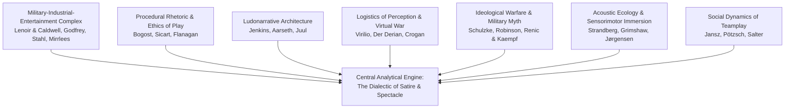

# 01. Research Brief & Methodology Blueprint

**Project Title:** War as Entertainment: Military Satire, Squad Identity, Destructive Gameplay, and the Spectacle of Violence in *Battlefield: Bad Company 2*  
**Alternative Working Titles:**
1. *Playing at War: Destruction, Humour, and the Construction of Military Identity in Battlefield: Bad Company 2*
2. *The Battlefield as a Playground: How Destructive Mechanics and Squad Narratives Transform Warfare into Interactive Entertainment*
3. *Laughing Through the Battlefield: Military Satire, Masculinity, Friendship, and the Representation of War in Bad Company 2*
4. *Between Satire and Spectacle: The Contradictions of Military Entertainment in Battlefield: Bad Company 2*

**Primary Discipline:** Game Studies  
**Secondary Disciplines:** Media Studies, Military Studies, Political Communication, Narrative Studies, Psychology of Interactive Media, Cultural Studies  
**Citation Style:** APA 7th Edition  
**Target Manuscript Length:** 7,000–9,000 words (excluding references and appendices)  
**Research Cutoff Date:** 3 November 2026  

---

## 1. Central Research Question

> **How does *Battlefield: Bad Company 2* combine military satire, squad-based storytelling, destructive gameplay, and multiplayer competition to construct an entertaining yet fundamentally contradictory representation of modern warfare?**

### Supporting Research Inquiries (RQ1–RQ10)

1. **RQ1 — Military Representation:** How does the game represent modern warfare through its campaign narrative, military organizations, combat hardware, environments, and geopolitical conflict?
2. **RQ2 — Military Satire & Parody:** How does the game deploy comedy, irreverence, character banter, and action-movie conventions to distinguish itself from, and satirize, conventional military shooters (notably *Call of Duty: Modern Warfare*)?
3. **RQ3 — Character Development:** How do Private Preston Marlowe, Sergeant Samuel Redford ("Sarge"), Private George Gordon Haggard Jr., and Specialist Terrence Sweetwater develop throughout the campaign, and how does their collective identity shape player positioning?
4. **RQ4 — Destruction as Gameplay Agency:** How does the Destruction 2.0 system (Frostbite 1.5) transform static digital architecture into an interactive, malleable, and strategically dynamic combat space?
5. **RQ5 — Squad Identity & Brotherhood:** How do squad relationships, profanity, comedic dispute, and shared peril construct an unconventional form of military brotherhood and homosocial bonding?
6. **RQ6 — Campaign vs. Multiplayer Epistemologies:** How do the campaign and multiplayer modes communicate divergent meanings of warfare, teamwork, tactical violence, destruction, and competitive achievement?
7. **RQ7 — Sound, Acoustics, and Sensory Immersion:** How do audio design, High Dynamic Range (HDR) mixing, weapon capture, environmental reverberation, and audiovisual-haptic synchronization generate visceral sensory pleasure?
8. **RQ8 — Geopolitical & Ideological Framing:** How does the narrative’s depiction of Russian aggression, Latin American operational spaces, CIA covert interventionism, and secret EMP weaponry construct global political meaning?
9. **RQ9 — The Spectacle of Destruction:** Does the celebration of structural collapse and explosive devastation challenge or reinforce the consumer appeal of simulated warfare?
10. **RQ10 — The Contradictions of Militainment:** Can an interactive military entertainment product meaningfully critique genre conventions and military heroism while deriving its primary commercial and ludic appeal from the aestheticization and tactile enjoyment of simulated violence?

---

## 2. Theoretical & Conceptual Architecture

The investigation synthesizes seven foundational theoretical traditions:

1. **Militainment and the Military-Entertainment Complex:** (Stahl, 2009; Lenoir & Caldwell, 2018; Godfrey, 2022). Examines how digital games commodify warfare into consumable spectacles, desensitizing civilian audiences while celebrating high-tech kinetic violence.
2. **Procedural Rhetoric and Ludic Ethics:** (Bogost, 2007; Sicart, 2009; Flanagan, 2009). Investigates what rules and systems communicate independent of authored text—specifically how Destruction 2.0 rewards environmental annihilation.
3. **Ludonarrative Tension and Architecture:** (Jenkins, 2004; Aarseth, 2007; Juul, 2005). Analyzes the gap between the campaign's satirical, ragtag narrative framing and the player's mechanical omnipotence as a lethal combat operative.
4. **Logistics of Perception and Virtuous War:** (Virilio, 1989; Der Derian, 2009; Crogan, 2011). Explores the intersection of simulation technologies, sensory immersion, and sanitized, "clean" destructive power.
5. **Critical Military Studies and the Law of Armed Conflict:** (Robinson, 2012, 2015, 2019; Schulzke, 2017; Renic & Kaempf, 2022). Assesses how *Bad Company 2* completely divorces massive civilian infrastructure destruction from international humanitarian law or civilian casualties.
6. **Acoustic Phenomenology:** (Grimshaw, 2014; Strandberg, 2010). Unpacks the psychological and affective power of HDR audio in constructing visceral, tactile experiences of concussive force.
7. **Masculinity and Homosocial Squad Bonding:** (Jansz, 2005; Huntemann & Payne, 2010; Payne, 2016). Evaluates how comedy, profanity, and anti-authoritarian camaraderie negotiate military masculinity.

---

## 3. Methodological Framework: Interpretive Qualitative Case Study

The research employs an intensive, multi-modal interpretive case-study methodology comprising nine analytical tracks:

1. **Ludonarrative Campaign Analysis:** Mission-by-mission reconstruction of all 13 single-player missions (Operation Aurora through Airborne). Evaluates narrative beats, environmental encounters, player objectives, character banter, and ludic constraints.
2. **Character & Relational Matrix:** Comparative examination of the four Bad Company operatives (Preston Marlowe, Samuel Redford, George Haggard, Terrence Sweetwater) alongside supporting figures (Flynn, Aguire, Kirilenko).
3. **Destruction 2.0 Systemic Audit:** Analysis of Frostbite 1.5's physical simulation parameters, structural health states, micro-destruction (bullet chipping) vs. macro-destruction (facade demolition and total building collapse / "2.0 hull down").
4. **Multiplayer Ludic Analysis:** Structural breakdown of classes (Assault, Engineer, Medic, Recon), game modes (Rush, Conquest, Squad Rush, Squad Deathmatch), combined-arms vehicular combat, spotting mechanics, and squad-respawn systems.
5. **Acoustic & Haptic Dissection:** Examination of DICE's High Dynamic Range (HDR) audio architecture, physical dynamic range culling, real-world recording methodologies, and the binding of audio output to camera-shake and controller haptics.
6. **Ideological & Geopolitical Deconstruction:** Post-Cold War geopolitical analysis of the Russian revanchist invasion, non-state proxy conflict in South America, covert US intelligence machinations, and the scalar deployment of weaponized EMPs.
7. **Developer Document & Intentionality Synthesis:** Critical comparison of documented developer statements (David Goldfarb on parodizing *Modern Warfare*; Patrick Bach on sandbox combat; Stefan Strandberg on HDR sound; Gordon Van Dyke on multiplayer balancing) against actual gameplay systems.
8. **Comparative Genre Contrast:** Controlled structural comparison with *Call of Duty 4: Modern Warfare* (2007) / *Modern Warfare 2* (2009) and *Battlefield: Bad Company* (2008).
9. **Rigorous Devil's Advocate Testing:** Systemic interrogation of the hypothesis via counter-critique: Does the game's satire perform genuine critical cultural work, or is it merely an ironic aesthetic veneer designed to sell conventional military-industrial pleasures?
