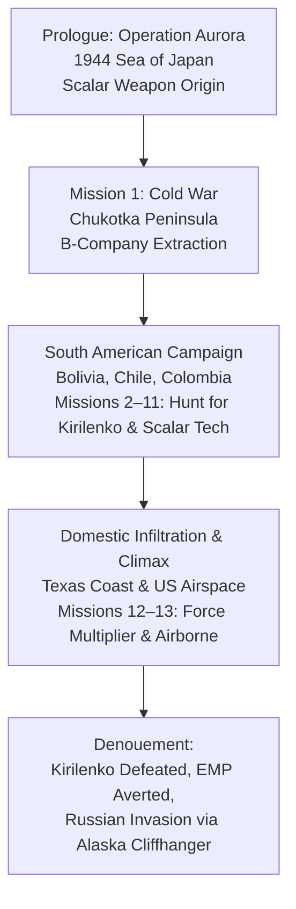

# 05. Exhaustive Campaign Ludonarrative Reconstruction & Evidence Matrix

**Project:** *Battlefield: Bad Company 2* Academic Investigation  
**Primary Ludic Text:** *Battlefield: Bad Company 2* (DICE / Electronic Arts, 2010)  
**Campaign Scope:** All 13 Single-Player Missions (Historical Prologue + 12 Contemporary Operations)  
**Analytical Framework:** Ludonarrative Analysis, Procedural Rhetoric, Ideological Deconstruction  

---

## 1. Comprehensive Narrative Architecture

The single-player campaign of *Battlefield: Bad Company 2* is structured around a two-tiered narrative arc: a historical World War II prologue establishing the provenance of a catastrophic superweapon, followed by a contemporary global crisis spanning the Russian Far East, Latin America, and the continental United States. 

---

## 2. Granular Mission-by-Mission Deconstruction

### Mission 0: Operation Aurora
- **Historical Era & Setting:** October 4, 1944; Sea of Japan, Imperial Japanese territorial waters.
- **Protagonist / Operatives:** US Commando operative Thomas Wyatt, alongside a squad of Marine raiders and Japanese-American defector/scientist Dr. Sadayuki.
- **Narrative Objectives:** Infiltrate a fortified Imperial Japanese naval fortress, secure Dr. Sadayuki, extract intelligence regarding a covert Imperial Japanese "Black Weapon" (a prototype scalar electromagnetic device), and rendezvous with an extraction submarine.
- **Key Plot Developments:** Upon infiltrating the facility, Wyatt’s unit secures the scalar device. During extraction aboard a transport vessel, the Japanese military triggers the device. A blinding, deafening acoustic and electromagnetic pulse detonates, triggering a catastrophic underwater shockwave and tsunami that obliterates the island, drowning Wyatt and the entire commando team.
- **Ludic & Mechanical Systems:** Linear tactical stealth transitioning to assault rifle combat (M1 Garand, Thompson SMG, Colt 1911). Introduction of scripted naval artillery bombardment.
- **Destruction Mechanics:** Early demonstration of concrete embrasure cracking and bunker wall breaching. The mission concludes with macro-environmental annihilation as the tsunami swallows the coastline.
- **Dialogue & Thematic Resonance:** Establishes the scalar device not merely as a conventional explosive, but as a legendary, almost occult technological terror—the ultimate MacGuffin uniting WWII secret-weapons mythology with modern technophobia.
- **Ideological Framing:** Anchors modern American geopolitical supremacy in WWII sacrifice, framing preemptive counter-proliferation as historically necessary.

---

### Mission 1: Cold War
- **Setting:** Contemporary winter; Chukotka Peninsula, Russian Federation (Siberian Arctic border).
- **Protagonist & Squad:** Private Preston Marlowe, Sergeant Samuel Redford ("Sarge"), Private George Gordon Haggard Jr., Specialist Terrence Sweetwater ("B-Company", 222nd Army Battalion).
- **Narrative Objectives:** Penetrate Russian sovereign territory in white snow-camo to locate a missing US intelligence counter-agent and recover a telemetry tracking package related to scalar weapon research.
- **Key Plot Developments:** Bad Company fights through Russian border patrols, locates the contact dead, retrieves the encrypted data drive, and executes a chaotic extraction under heavy mortar fire. Sarge notes that this mission was supposed to be their final assignment before his honorable retirement.
- **Ludic & Mechanical Systems:** Introduction of squad-based first-person mechanics, silenced combat (AN-94, XM8), weapon pick-ups, health regeneration, and red-explosive barrel hazards.
- **Destruction Mechanics:** Destruction 2.0 introduction in arctic wooden villages: high-caliber small arms shred wooden shacks; 40mm underslung grenade launchers demolish wall partitions, exposing Russian conscripts.
- **Dialogue & Characterization:** Establishes the squad’s signature dynamic. Sweetwater neurotically panics about freezing to death; Haggard exhibits gleeful enthusiasm for blowing up Siberian outposts; Sarge displays world-weary cynicism toward command; Marlowe acts as the steady tactical core.
  - *Sweetwater:* "I can't feel my legs, Sarge! And not in a heroic way, in a gangrenous way!"
  - *Haggard:* "Cheer up, Sweetcheeks! If your legs fall off, you won't have to carry your pack!"
- **Ideological Implications:** Normalizes unauthorized sovereign cross-border incursions by US forces into nuclear-armed Russian territory as casual, routine intelligence sweeps.

---

### Mission 2: Heart of Darkness
- **Setting:** Dense jungle river valley; Northern Bolivia.
- **Narrative Objectives:** Navigate upriver aboard a patrol boat to contact CIA Special Activities Division operative Agent Aguire, who possesses intelligence linking Russian scalar research to local paramilitary networks.
- **Key Plot Developments:** The squad encounters heavily armed local militia and Russian Spetsnaz advisers operating in sovereign Bolivian territory. They link up with Aguire, who reveals that Russian ultranationalist Colonel Arkady Kirilenko is overseeing the deployment of the scalar weapon.
- **Ludic & Mechanical Systems:** On-rails patrol boat minigun defense transitioning into dense jungle infantry clearing. Introduction of vertical combat amidst river docks and wooden stilt villages.
- **Destruction Mechanics:** High-velocity minigun fire systematically chews through corrugated metal, wooden piers, and palm-leaf watchtowers. Structural supports collapse into the river.
- **Dialogue & Satire:** Explicit action-movie parody referencing *Apocalypse Now* and *Heart of Darkness*. The squad openly jokes about the absurdity of being sent from the freezing Arctic into the sweltering jungle without a briefing or appropriate uniform change.
- **Political Dimension:** Latin America is presented as an ungoverned, porous operational vacuum where foreign superpowers, corrupt mercenaries, and indigenous proxies wage unacknowledged proxy wars.

---

### Mission 3: Upriver
- **Setting:** Interior jungle hills and fortified timber logging camp; Bolivia.
- **Narrative Objectives:** Infiltrate Aguire’s secondary compound, eliminate hostile Russian forward reconnaissance patrols, and secure intelligence files detailing Kirilenko's logistics route.
- **Key Plot Developments:** Bad Company establishes that Kirilenko is using South America as a staging ground to transport the scalar device northward toward the United States border.
- **Ludic & Mechanical Systems:** Medium-range tactical engagements (M16A2, shotgun breaching, stationary heavy machine guns). Integration of combat optics and grenade tossing.
- **Destruction Mechanics:** First substantial appearance of reinforced concrete bunkers alongside timber structures. Players discover that small arms cannot penetrate concrete, requiring RPG-7s or 40mm grenades to blast firing apertures.
- **Squad Dynamics:** Deepening friction between Sarge’s desire to keep his men alive until his retirement papers clear and Aguire’s reckless, opaque intelligence directives.

---

### Mission 4: Crack the Sky
- **Setting:** High-altitude Bolivian Andes mountains; sub-alpine logging trail and abandoned meteorological station.
- **Narrative Objectives:** Escort Aguire to a crashed Russian spy satellite to extract the quantum encryption key before Kirilenko's salvage teams can purge the memory drives.
- **Key Plot Developments:** Bad Company utilizes a quad bike and tactical transport, assaults the meteorological facility, defends the crash site against waves of Russian airborne troops, and extracts the satellite's primary server module.
- **Ludic & Mechanical Systems:** Light vehicular driving (quad bike), defensive wave-based perimeter security, anti-aircraft missile targeting (tracking hostile Hind helicopters).
- **Destruction Mechanics:** Destruction of radio towers and structural outposts. Rocket strikes collapse corrugated iron hangars onto enemy technical vehicles.
- **Comedic Interlude:** Haggard engages in an absurd debate with Sweetwater regarding the nature of the "Dallas Cowboys Cheerleaders" and geopolitical conspiracies while pinned down under sniper fire.

---

### Mission 5: Snowblind
- **Setting:** Severe blizzard, freezing alpine ridge, and glacier pass; Bolivian Andes.
- **Narrative Objectives:** Survive catastrophic hypothermia following a helicopter insertion failure, descend the mountain through freezing winds, and link up with eccentric helicopter transport pilot Flynn.
- **Key Plot Developments:** Separated from their heavy transport in a sub-zero storm, Marlowe must sprint between fire pits, burning barrels, and sheltered interior rooms to avoid freezing to death. The squad reunites and eliminates a heavily fortified Russian base camp.
- **Ludic & Mechanical Systems:** Innovative environmental hazard mechanic: Marlowe’s body temperature drops continuously when exposed to the blizzard (represented by frosted screen edges and shivering audio); player must seek heat sources within strict time limits.
- **Destruction Mechanics:** Tactical demolition of enemy shelter shacks. Paradoxically, players must destroy buildings to flush out snipers, yet preserve small rooms with burning barrels to survive the cold.
- **Affective Dimension:** Shifts tone from expansive power fantasy to frantic, desperate vulnerability, grounded by sensory audio of howling alpine winds and teeth-chattering voice performance.

---

### Mission 6: Heavy Metal
- **Setting:** Scorched arid desert basins, wind turbine farms, and salt flats; Atacama Desert, Northern Chile.
- **Narrative Objectives:** Spearhead an armored US division offensive, commandeer an M1A2 Abrams main battle tank, destroy Russian T-90 armor columns, neutralize anti-tank missile batteries, and secure an abandoned mining village.
- **Key Plot Developments:** Unveils the scale of the broader geopolitical war: the Russian military has launched a massive, conventional combined-arms invasion across South America. Bad Company serves as the armored spearhead for regular US military forces.
- **Ludic & Mechanical Systems:** Combined-arms vehicle simulation: main cannon ballistics, coaxial machine gun, targeting thermal optics, and calling in UAV drone laser strikes.
- **Destruction Mechanics:** Pinnacle of Destruction 2.0 demonstration: 120mm tank shells blast entire two-story adobe and brick buildings into clouds of dust and rubble. Multi-story concrete warehouses suffer total pancake collapses ("2.0 hull down") when supporting corners are systematically destroyed.
- **Thematic Resonance:** Showcases the unbridled kinetic empowerment of mechanized warfare. Violence becomes an intoxicating audio-visual symphony of explosive concussive blasts.

---

### Mission 7: High Value Target
- **Setting:** Arid desert canyon and fortified adobe settlement; Atacama, Chile.
- **Narrative Objectives:** Infiltrate the settlement aboard an armored Humvee, locate and rescue a downed US surveillance drone operator, and ambush Kirilenko’s personal escort convoy.
- **Key Plot Developments:** Kirilenko slips through the perimeter, leaving behind decoded naval manifests pointing to an enigmatic dry dock in the middle of the desert.
- **Ludic & Mechanical Systems:** Mobile vehicular machine gun defense, building-to-building room clearance, and close-quarters urban infantry assault.
- **Destruction Mechanics:** Micro-destruction of residential walls, interior plaster, and wooden doorframes, exposing enemy soldiers hiding behind cover.

---

### Mission 8: Sangre del Toro
- **Setting:** Vast dried seabed, abandoned salt flats, and rusting naval wrecks; Atacama Desert, Chile.
- **Narrative Objectives:** Locate the derelict World War II Imperial Japanese cargo freighter *Sangre del Toro*—mysteriously stranded in the middle of the desert miles from the contemporary coastline—and retrieve the original scalar weapon core.
- **Key Plot Developments:** The squad discovers that the 1944 Japanese weapon test from Operation Aurora caused an immediate seismic uplift, stranding the ship on an elevated seabed. Upon boarding the rusted hull, Marlowe discovers the dead remains of the Japanese crew and secures the scalar weapon's compression core. However, Kirilenko ambushes them, takes the core, and reveals that Agent Aguire was a double agent who traded the device in exchange for personal protection. Kirilenko executes Aguire on the spot, leaving Bad Company to die in the exploding wreck.
- **Ludic & Mechanical Systems:** Open-world sandbox driving (4x4 buggy) across a vast non-linear desert map. Players choose the sequence in which to investigate three triangulation monitoring stations before accessing the ship.
- **Destruction Mechanics:** Destruction of isolated desert radar compounds and container barracks. The ship's interior features tight corridor gunfights amidst rusting bulkheads.
- **Narrative Turning Point:** The squad is betrayed by the US intelligence apparatus (Aguire). Bad Company realizes they are entirely on their own, transforming from reluctant military conscripts into rogue avengers fighting to prevent national annihilation.

---

### Mission 9: No One Gets Left Behind
- **Setting:** Deep mountainous jungle and fortified prison compound; Colombia.
- **Narrative Objectives:** Locate and rescue their hippie, pacifist helicopter pilot Flynn, who was captured by Russian mercenaries after being shot down while providing unauthorized extraction.
- **Key Plot Developments:** Defying military orders to withdraw, Bad Company mounts an unauthorized rescue operation into sovereign Colombian territory. They locate Flynn, who is being interrogated by Russian paramilitaries, and fight their way out to a secondary helicopter pad.
- **Ludic & Mechanical Systems:** Sniper reconnaissance (M24, Barrett .50 cal), coordinated synchronized takedowns timed to thunderclaps, and assault rifle CQB.
- **Squad Camaraderie:** The rescue of Flynn solidifies the squad's ethical compass. While they despise institutional military bureaucracy and flag-waving rhetoric, their loyalty to their eccentric comrade is absolute. Flynn's dialogue—mixing peaceful New Age mysticism with frantic evasive helicopter piloting—provides rich comedic relief.

---

### Mission 10: Zero Dark Thirty
- **Setting:** Heavy tropical downpour, canal basin, and industrial shipping port; Colombia.
- **Narrative Objectives:** Infiltrate the Colombian container port under cover of night, neutralize the defensive perimeter, and board Kirilenko’s heavily guarded cargo transport vessel before it departs for the Gulf of Mexico.
- **Key Plot Developments:** Bad Company fights through container yards and gantry cranes. Flynn flies overhead, providing aerial minigun fire. As the squad boards the vessel, Russian surface-to-air missiles shoot down Flynn's helicopter, killing him. The squad watches his crash in grief, hardening their resolve to eliminate Kirilenko.
- **Ludic & Mechanical Systems:** Night-vision and flashlight combat, silencers, vertical climbing on shipping containers, and heavy combat against elite Spetsnaz shock troops.
- **Destruction Mechanics:** High explosives blow shipping containers into twisted scrap metal; concrete dock offices collapse under RPG fire.
- **Affective Tone:** The comedic banter ceases abruptly upon Flynn’s death, marking the narrative's pivot into earnest action-thriller melodrama.

---

### Mission 11: Force Multiplier
- **Setting:** Industrial oil docks and maritime canal; Texas Coastline / US Gulf of Mexico.
- **Narrative Objectives:** Re-enter sovereign United States territory, eliminate Russian diversionary forces holding the harbor, and breach the fortified runway where Kirilenko is loading the scalar EMP weapon onto a super-heavy An-225 transport aircraft.
- **Key Plot Developments:** The war reaches domestic soil. Russian forces have bypassed the US early-warning radar network and are preparing to detonate the scalar EMP at high altitude over Texas, which would permanently paralyze the entire continental US power grid and civilian communication infrastructure.
- **Ludic & Mechanical Systems:** High-intensity urban combat, anti-armor rocket strikes against infantry fighting vehicles (BMP-3), and breaching secured air-traffic control gates.
- **Destruction Mechanics:** Industrial infrastructure demolition: oil tanks explode in massive fireballs, concrete loading docks crumble, and security towers collapse.

---

### Mission 12: Airborne
- **Setting:** Stratospheric airspace over the southern United States; interior of an An-225 cargo aircraft.
- **Narrative Objectives:** Infiltrate the cargo bay during takeoff, fight through the pressurized fuselage, destroy the scalar weapon before it can trigger its high-altitude EMP pulse, eliminate Colonel Kirilenko, and parachute into American airspace.
- **Key Plot Developments:** The squad breaches the cockpit and cargo bays in a climactic airborne assault. Marlowe sabotages the scalar weapon’s stabilization couplings with C4 explosives. The weapon detonates internally, rupturing the aircraft hull and initiating explosive decompression. In the falling debris, Kirilenko grabs a parachute and attempts to execute Marlowe mid-air. Sweetwater tackles Kirilenko, allowing Marlowe to draw his sidearm and shoot Kirilenko through the head in freefall. Marlowe pulls his ripcord, and Bad Company lands safely in a Texas suburb.
- **Denouement & Final Dialogue:** As the squad gathers their breath, expecting to finally relax and enjoy Sarge’s retirement, US Army helicopters arrive. A high-ranking officer informs them that although the scalar EMP was destroyed, Russian conventional military forces have initiated a massive, full-scale invasion of North America through Alaska and Canada. Sarge drops his head in exasperation as Haggard excitedly yells that they get to go back to war.
  - *Sarge:* "I am never gonna get out of this damn army."
  - *Haggard:* "Hell yeah! The Russians are in Alaska! It's snow season, baby!"
- **Ludic & Mechanical Systems:** Scripted cinematic combat, pressurized cabin gunfights with rapid decompression physics, mid-air skydiving shootout sequence.

---

## 3. Systematic Campaign Ludonarrative Evidence Matrix

| Mission # & Title | Setting & Mode | Narrative Objective | Mechanics & Weapons | Destruction 2.0 Manifestation | Dialogue & Banter | Ideological & Political Meaning | Source Evidence |
|---|---|---|---|---|---|---|---|
| **0. Operation Aurora** | 1944 Sea of Japan (Campaign) | Secure Dr. Sadayuki & prototype scalar weapon | M1 Garand, Thompson, naval artillery | Bunker wall fracturing; coastal tsunami obliteration | Sadayuki warns of "the black sun"; Wyatt dies in extraction | Frames US intervention as a historic duty against WMDs | Mission text; Bach (2010) |
| **1. Cold War** | Siberian Arctic (Campaign) | Extract deceased CIA contact & telemetry drive | AN-94, XM8, silenced pistols, grenades | Wooden shacks shredded by 5.45mm fire; 40mm facade collapse | Sweetwater complains of frostbite; Haggard mocks him | Sovereignty violation normalized as casual reconnaissance | Mission text; Goldfarb (2022a) |
| **2. Heart of Darkness** | Bolivian River (Campaign) | Navigate river; link up with Agent Aguire | On-rails minigun, assault rifle river clearing | Pier supports chewed through; watchtowers collapse into river | Squad jokes about being in the wrong uniform/jungle | Latin America framed as ungoverned, violent playground | Mission text; Payne (2016) |
| **3. Upriver** | Bolivian Jungle (Campaign) | Clear logging camp; secure Kirilenko transit route | M16A2, C4 breaching, heavy machine guns | Small arms fail on concrete; RPGs breach sniper perches | Sarge questions CIA authority; Haggard praises explosives | CIA unaccountability juxtaposed with soldier expendability | Mission text; Robinson (2012) |
| **4. Crack the Sky** | Bolivian Andes (Campaign) | Recover quantum satellite encryption key | Quad bike driving, AA missile targeting | Radio towers felled; corrugated hangars pancaked on vehicles | Haggard & Sweetwater debate cheerleaders under sniper fire | Global surveillance assets treated as disposable kinetic prizes | Mission text; Crecente (2009) |
| **5. Snowblind** | Alpine Blizzard (Campaign) | Survive hypothermia; descend to Flynn’s LZ | Temperature timer, fire pits, thermal beacons | Demolishing enemy cover while preserving heated shacks | Marlowe’s teeth chatter; Flynn babbles over radio | Fragility of human life amidst severe physical elements | Mission text; Strandberg (2010a) |
| **6. Heavy Metal** | Atacama Desert (Campaign) | Armored spearhead assault; destroy Russian tanks | M1A2 Abrams cannon, TOW missiles, UAV laser | Full "2.0 hull down" multi-story concrete building pancake collapse | Tank crew cheers over radio at massive concussive hits | Kinetic omnipotence celebrated; war as aesthetic spectacle | Mission text; Godfrey (2022) |
| **7. High Value Target** | Atacama Village (Campaign) | Rescue downed drone operator; ambush convoy | Humvee mounted gun, CQB shotgun clearing | Micro-destruction of interior walls, doors, and fences | Squad trades insults over navigation errors | Erasure of civilian spaces; architecture as pure cover | Mission text; Renic & Kaempf (2022) |
| **8. Sangre del Toro** | Atacama Seabed (Campaign) | Investigate stranded WWII ship; retrieve EMP core | Open sandbox buggy driving, 4x4 triangulation | Demolition of isolated radar masts; rusted hull CQB | Discovery of scalar origin; Aguire executes treason | State intelligence betrayal; Bad Company goes rogue | Mission text; Van den Heede (2018) |
| **9. No One Gets Left Behind** | Colombian Jungle (Campaign) | Unauthorized rescue of captured pilot Flynn | M24 sniper, synchronized thunder shots | Guard towers collapsed into ravines by C4 charges | Flynn thanks squad with peace-sign philosophy | Squad loyalty supersedes military command and borders | Mission text; Jansz (2005) |
| **10. Zero Dark Thirty** | Colombian Port (Campaign) | Board Kirilenko’s ship; secure scalar transport | Night optics, silencers, heavy Spetsnaz CQB | Shipping containers buckled; crane gantries collapsed | Flynn killed in helicopter crash; banter ceases | Tragic melodrama deployed to sanctify lethal vengeance | Mission text; Schulzke (2017) |
| **11. Force Multiplier** | Texas Coast (Campaign) | Breach harbor runway; stop An-225 transport | Anti-armor rockets, heavy MG, urban clearing | Oil fuel tanks explode; concrete terminal walls demolished | Squad realizes war is on domestic soil | Domestic vulnerability activates patriotic defense tropes | Mission text; Mirrlees (2016) |
| **12. Airborne** | US Airspace (Campaign) | Sabotage scalar EMP mid-flight; defeat Kirilenko | Cabin CQB, explosive decompression, skydiving | Pressurized fuselage torn open; cargo bay disintegration | Kirilenko executed mid-air; cliffhanger Russian invasion | War converted into Hollywood action-cinema climax | Mission text; Goldfarb (2022a) |
