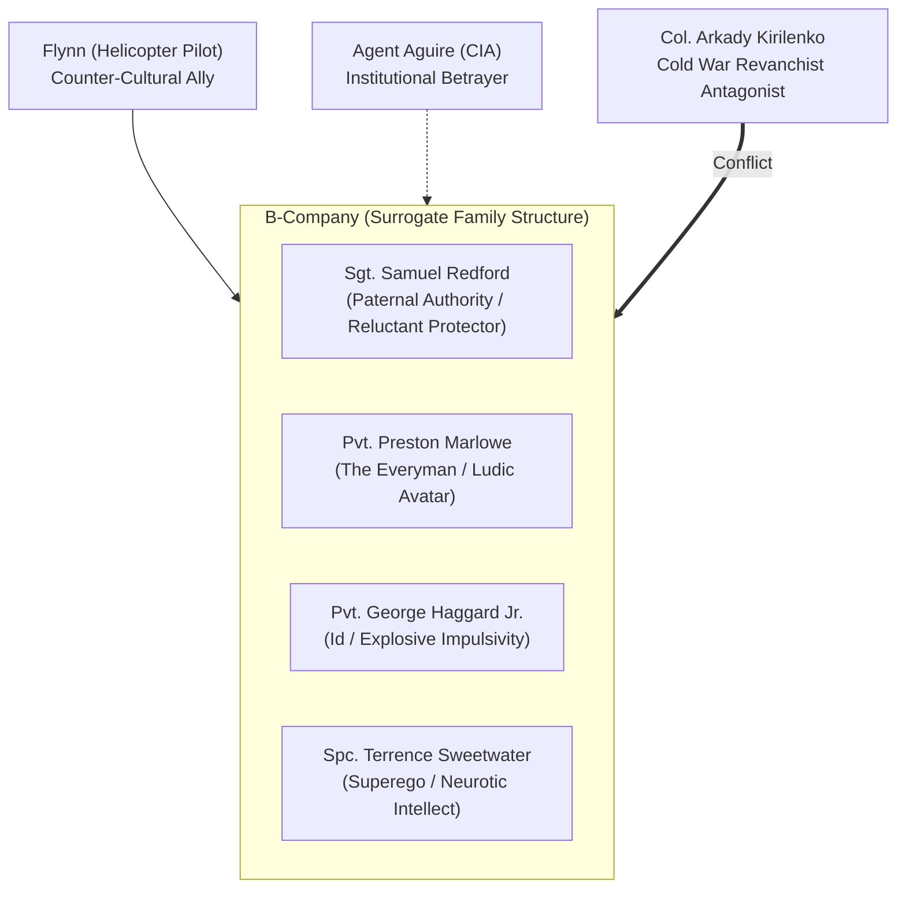

# 06. Character Arcs, Squad Dynamics, and the Politics of Military Masculinity

**Project:** *Battlefield: Bad Company 2* Academic Investigation  
**Primary Subjects:** The Operatives of B-Company, 222nd Army Battalion & Supporting Figures  
**Analytical Framework:** Interpersonal Dynamics, Homosocial Bonding, Ludonarrative Role-Play, Masculinity Studies  

---

## 1. The Squad as Dysfunctional Fraternity

Unlike the hyper-stoic, elite operators of contemporary military shooters (such as Captain Price and "Soap" MacTavish in *Call of Duty: Modern Warfare*), "Bad Company" (the 222nd Army Battalion) consists of military castoffs, disciplinary misfits, and reluctant conscripts. Assigned to hazardous forward reconnaissance operations because their lives are deemed expendable by US Army high command, the squad develops an insular, deeply cynical, yet fiercely loyal collective identity.



The squad functions as a classic tripartite psychological apparatus anchored by a paternal stabilizer:
- **George Haggard** functions as the collective **Id**: driven by unrestrained destructive impulse, explosive desire, and primal enjoyment of physical ruin.
- **Terrence Sweetwater** operates as the **Superego**: an anxious, intellectual moralist constantly cataloging legal regulations, physical perils, and geopolitical absurdities.
- **Preston Marlowe** serves as the **Ego / Avatar**: mediating between Haggard's chaos and Sweetwater's neurotic restraint, translating their dynamic into tactical player action.
- **Sergeant Samuel Redford** provides the **Paternal Reality Principle**: an exhausted professional attempting to navigate bureaucratic command, enforce minimal discipline, and bring his "kids" home alive before his retirement.

---

## 2. Granular Profiles of Core Personas

### Private Preston Marlowe: The Grounded Avatar
- **Military Background & Status:** Marlowe was reassigned to Bad Company after accidentally crashing a limousine belonging to an Army general while joyriding. He serves as the squad's point-man and rifleman.
- **Psychological Construction:** Marlowe is characterized by laconic pragmatism, dry wit, and unpretentious competence. Unlike conventional action heroes who deliver grandiose patriotic speeches, Marlowe treats warfare as an absurd, dangerous job that must be survived.
- **Ludonarrative Tension:** A profound dissonance exists between Marlowe’s narrative persona and his mechanical capabilities. In cutscenes and squad dialogue, Marlowe is presented as an ordinary soldier who is frequently out of his depth. In gameplay, however, the player controls Marlowe as a cybernetic killing machine capable of single-handedly wiping out mechanized battalions, shooting down attack helicopters with anti-tank rockets, and collapsing whole villages with surgical demolition charges.

### Sergeant Samuel Redford: The Reluctant Father Figure
- **Military Identity & Command Philosophy:** Redford is a seasoned veteran who volunteered for Bad Company in exchange for an expedited retirement package. He is a consummate military professional who has grown utterly disillusioned with geopolitical posturing and brass incompetence.
- **Leadership Dynamics:** Redford's authority is never derived from rigid authoritarian discipline, but from earned respect, moral decency, and tactical competence. He constantly threatens court-martials that he never executes, acting as a buffer between high command's suicidal orders and his soldiers' lives.
- **Character Evolution:** Throughout *Bad Company 2*, Redford's retirement is repeatedly postponed by corrupt CIA mandates. His arc is defined by growing protective ferocity: when Flynn is captured, Redford formally abandons standard military protocol, choosing criminal insubordination over abandoning a comrade.

### Private George Gordon Haggard Jr.: The Personification of Destructive Pleasure
- **Background & Disposition:** Hailing from small-town Texas, Haggard was reassigned to Bad Company after detonating an ammunition depot. He is impulsive, uneducated, unabashedly vulgar, and deeply obsessed with high explosives.
- **Ludic-Thematic Function:** Haggard represents the comedic, unmediated embodiment of the player's own pleasure in Destruction 2.0. When players blast open a concrete wall with a grenade launcher or level a sniper tower with C4, Haggard vocally cheers over the radio, validating the player's appetite for kinetic spectacle. He collapses the boundary between character psychology and game mechanics: Haggard is who the player becomes when handed an unconstrained destruction engine.
- **Masculinity & Humor:** Haggard embodies a caricatured rural American working-class masculinity, combining folksy aphorisms, conspiratorial paranoia, and sincere affection for his squadmates.

### Specialist Terrence Sweetwater: The Neurotic Intellectual
- **Background & Technical Role:** Sweetwater was assigned to Bad Company after uploading an unauthorized computer virus into the Army’s payroll server while attempting to fix a financial glitch. He serves as the squad’s communications technician and intelligence analyst.
- **Narrative Function:** Sweetwater is the voice of intellectual skepticism. He questions the legality of their missions, points out the geopolitical hypocrisy of US foreign policy, and panics about infectious diseases, frostbite, and structural collapses.
- **Antagonistic Camaraderie with Haggard:** The verbal sparring between Haggard and Sweetwater forms the comedic core of the game. Their debates—ranging from Cheerleader regulations to geopolitical philosophy—occur organically during long traversal sequences and intense firefights, injecting civilian domestic absurdity into lethal combat spaces.

### Supporting Figures: Flynn, Aguire, and Kirilenko
- **Flynn (The Counter-Cultural Pilot):** Flynn is an eccentric civilian-contractor helicopter pilot clad in tropical shirts who plays psychedelic rock and advocates holistic New Age philosophies while navigating anti-aircraft fire. His eventual death in Mission 10 strips the campaign of its whimsical levity, providing the moral catalyst for the squad’s final assault.
- **Agent Aguire (The Cynical State Apparatus):** Aguire personifies the unaccountable, Machiavellian nature of US intelligence agencies. He treats Bad Company as disposable cannon fodder and ultimately trades the scalar weapon to Kirilenko to save his own skin, cementing the narrative's deep cynicism toward government institutions.
- **Colonel Arkady Kirilenko (The Revanchist Villain):** Kirilenko is a ruthless Russian ultranationalist seeking to reverse the collapse of the Soviet empire through technological terror. His characterization adheres strictly to traditional Cold War cinematic tropes, providing an unambiguous, morally monstrous foreign adversary that legitimizes the squad's extreme violence.

---

## 3. Systematic 12-Dimension Character Analysis Matrix

| Dimension | Pvt. Preston Marlowe | Sgt. Samuel Redford | Pvt. George Haggard Jr. | Spc. Terrence Sweetwater | Flynn | Agent Aguire | Col. Arkady Kirilenko |
|---|---|---|---|---|---|---|---|
| **1. Initial Identity** | Careless young soldier; general's limousine crasher | Exhausted veteran counting days to pension | Texas pyro-maniac; ammo dump demolisher | Nerdy communications tech; payroll hacker | Hippie civilian chopper pilot; pacifist slacker | Shadowy CIA Special Activities operative | Ultranationalist Russian Spetsnaz commander |
| **2. Core Motivation** | Surviving missions; protecting squad; getting home | Preserving his men's lives; securing retirement | Detonating high explosives; thrill-seeking | Surviving combat; proving intellectual worth | Helping the boys; flying; staying relaxed | Achieving mission parameters; personal survival | Restoring Russian imperial dominance |
| **3. Observable Personality** | Laconic, ironic, observant, tactically grounded | Stern, world-weary, paternal, fiercely protective | Impulsive, boisterous, uninhibited, uneducated | Anxious, neurotic, pedantic, hyper-articulate | Whimsical, New Age, laid-back, loyal | Cold, secretive, manipulative, transactional | Sadistic, fanatical, megalomaniacal, ruthless |
| **4. Military Rank & Role** | Private; Point-man, Lead Infantry Rifleman | Sergeant; Squad Leader, Tactical Commander | Private; Demolitions Specialist, Breacher | Specialist; Tech Support, Radio / Comms | Civilian Contractor; UH-60 Transport Pilot | CIA Field Agent; Handler / Liaison | Colonel; Russian Armed Forces Commander |
| **5. Core Relationships** | Loyal to Sarge; mediates Haggard & Sweetwater | Paternal to all three; respects Marlowe | Antagonistic to Sweetwater; reveres Sarge | Verbally spars with Haggard; relies on Sarge | Friendly with B-Company; comedic foil | Exploits B-Company; allied with Kirilenko | Antagonist to US; executes Aguire |
| **6. Character Arc** | Matures from passive follower to lethal avenger | Shifts from bureaucratic duty to moral rebellion | Channels wild impulse into selfless squad rescue | Overcomes physical cowardice to tackle Kirilenko | Sacrifices life providing aerial fire support | Degenerates from state agent to executed traitor | Escalates from proxy warfare to domestic EMP strike |
| **7. Contribution to Humour** | Dry situational one-liners and deadpan reactions | Exasperated paternal sighs and sarcastic threats | Explosive enthusiasm, absurd analogies, vulgarity | Neurotic complaints, intellectual pedantry | Zen Buddhist philosophy under anti-aircraft fire | Zero humor (serves as serious foil to squad) | Melodramatic villain monologues |
| **8. Central Contradiction** | Ordinary guy persona vs. mass-murdering god of war | Despises the Army yet excels as an infantry leader | Loving comrade who delights in total devastation | Despises violence yet assists lethal military strikes | Pacifist ethos while piloting an armed combat gunship | Claims national security goals while trading WMDs | Claims Russian glory while operating as a rogue butcher |
| **9. Narrative Function** | Primary lens of player identification & action | Moral anchor and institutional authority buffer | Comic relief and emotional catalyst for chaos | Intellectual exposition and pacing contrast | Mobile extraction agent and tragic turning point | Catalyst of betrayal and anti-institutional critique | Primary geopolitical obstacle and final boss |
| **10. Symbolic Function** | The American Everyman caught in geopolitical gears | The betrayed veteran; the erosion of state loyalty | The id of militarism; pleasure of kinetic destruction | The civilian conscience militarized against its will | Counter-culture co-opted by the war machine | The deep state; duplicitous intelligence apparatus | The resurrected Cold War boogeyman |
| **11. Player Identification** | Direct mechanical surrogate (first-person camera) | Respected mentor figure guiding tactical flow | Avatar of player's destructive id and explosive joy | Surrogate for player's real-world fear & skepticism | Beloved sidekick whose loss sparks player fury | Target of player distrust and moral contempt | Cathartic target of ultimate lethal retribution |
| **12. Final Synthesis** | Humanizes state violence through ironic detachment | Subverts hierarchy by prioritizing human fraternity | Bridges destructive mechanics and narrative pleasure | Articulates the absurdity of military intervention | Proves the human cost of armed proxy conflict | Demonstrates the moral bankruptcy of statecraft | Legitimizes US violence through external villainy |

---

## 4. Collective Squad Dynamics & Ensemble Voice Performance

A crucial finding of this analysis is that the squad’s memorable characterization was directly engineered through innovative production methodologies. As documented by Stefan Strandberg (2010b) and David Goldfarb (2022b), DICE rejected the industry standard of recording voice actors in isolated sound isolation booths reading disjointed script prompts. 

Instead, the four lead actors (Bruce DuBose as Marlowe, Keith Szarabajka as Redford, Nigel de Long as Haggard, and Anton Beablau as Sweetwater) were recorded together in collaborative, multi-microphone ensemble sessions. This allowed the actors to interrupt one another, overlap dialogue, improvise expletives, and establish organic rhythmic timing. The resulting voice performance transforms dialogue from scripted exposition into authentic, lived-in camaraderie.

```mermaid
sequenceDiagram
    participant H as Haggard (Impulsive Id)
    participant S as Sweetwater (Anxious Intellect)
    participant R as Sarge (Paternal Leader)
    participant M as Marlowe (Tactical Ego / Player)

    H->>S: Initiates absurd debate (e.g., Cheerleaders / Aliens)
    S-->>H: Retorts with neurotic pedantry & regulatory facts
    Note over H,S: Rapid overlapping banter under hostile artillery fire
    R->>H: Threatens severe disciplinary action / court-martial
    R->>S: Commands tactical silence & situational awareness
    M->>R: Delivers dry, deadpan tactical observation
    R->>M: Issues core tactical order: "Take 'em out, Marlowe!"
    M-->>H: Breaches wall; Haggard cheers uncontrollably
```

### The Ideological Function of Military Brotherhood
In evaluating RQ5 and RQ10, this homosocial fraternity serves an ambivalent cultural function. On one hand, the squad's irreverent banter humanizes soldiers, exposing the tragic gap between elite political agendas and the working-class grunt who must bleed for them. On the other hand, this intense fraternal charm sanitizes the reality of state-sanctioned violence. By focusing the player's emotional investment entirely on the survival and witty banter of four lovable American soldiers, the game systematically marginalizes the human reality of the foreign combatants and foreign civilian populations whose towns and homes B-Company joyfully obliterates.

