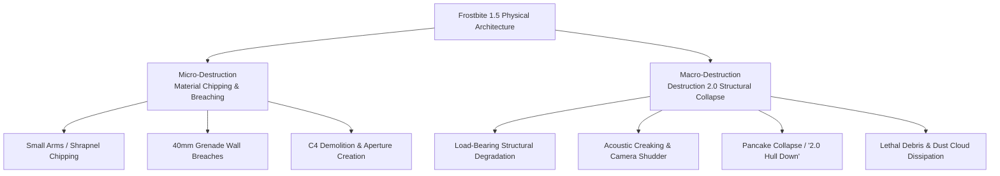
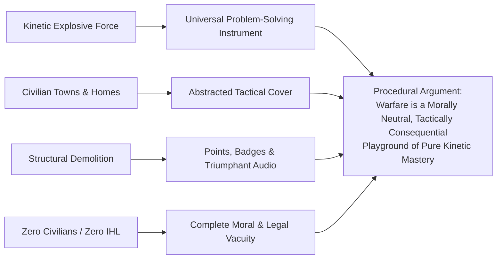

# 08. Destruction 2.0: Frostbite 1.5, Procedural Annihilation, and the Ethics of Play

**Project:** *Battlefield: Bad Company 2* Academic Investigation  
**Core Technologies:** Frostbite 1.5 Game Engine & Destruction 2.0 Physical Simulation Suite  
**Primary Theoretical Frameworks:** Procedural Rhetoric (Bogost), The Ethics of Play (Sicart), Architecture as Narrative (Jenkins), The Law of Armed Conflict (Renic & Kaempf)  

---

## 1. Technological Architecture: The Evolution of Frostbite 1.5

When EA DICE released the original *Battlefield: Bad Company* in 2008, it debuted the first iteration of the **Frostbite engine** (version 1.0). Frostbite 1.0 introduced "Destruction 1.0," which allowed players to blow holes in exterior walls and fell selected trees using high-explosive ordnance (RPGs, grenades, tank shells). However, Destruction 1.0 suffered from profound structural limitations: building skeletons, load-bearing pillars, interior stairwells, and roofs remained indestructible. While players could strip a building down to its concrete frame, the structure itself remained permanently standing.

With *Battlefield: Bad Company 2* (2010), DICE deployed **Frostbite 1.5**, featuring the revolutionary **Destruction 2.0** system (Bach, 2010; Crecente, 2009). Destruction 2.0 expanded environmental destruction along two distinct physical axes:

1. **Micro-Destruction (Material-Specific Breaching):** Frostbite 1.5 modeled distinct material properties. Thin sheet metal, wooden fencing, and drywall could be penetrated and chipped away by sustained small-arms fire (5.56mm, 7.62mm). Heavier explosive ordnance (40mm underslung grenades, hand grenades, C4) blasted gaping, irregular apertures through brick and exterior cinderblock walls, colloquialized by players as "creating your own doors."
2. **Macro-Destruction (Total Structural Collapse / "2.0 Hull Down"):** The defining technical achievement of Destruction 2.0 was systemic building collapse. Every multi-story residential building, commercial warehouse, and outpost structure possessed an internal skeletal integrity tracking algorithm. If a player systematically destroyed a critical threshold of the building's exterior load-bearing walls or corner pillars (typically 4 to 6 structural segments), the physics engine triggered a catastrophic structural failure:
   - **Phase 1: Audio Warning:** Loud structural groanings, concrete cracking, and groaning timber audio cues reverberated through the structure.
   - **Phase 2: Visual Cues:** Dust fell from ceilings, interior walls buckled, and camera-shake intensified.
   - **Phase 3: Pancake Collapse:** The entire multi-story building collapsed downward into its own footprint ("pancake collapse"), obliterating interior rooms, flattening anyone inside, and leaving behind a pile of permanent concrete rubble and a lingering volumetric dust cloud.

---

## 2. Technical Limitations & Structural Exceptions

To maintain computational performance on seventh-generation consoles (PlayStation 3 and Xbox 360, which operated with only 256MB to 512MB of unified system memory) and ensure multiplayer map balance, Destruction 2.0 was not an unconstrained, infinitely granular voxel simulation. It operated under strict technical boundaries:

- **Pre-Fractured Geometric Meshes:** Walls did not deform continuously; they broke along pre-authored fracture patterns upon receiving damage surpassing defined energy thresholds.
- **Indestructible Structural Anchors:** Concrete foundation slabs, steel interior stairwells, certain large industrial warehouses, and primary geographical terrain features (mountain bedrock, large boulders) remained immutable to prevent maps from becoming completely flat featureless voids.
- **Terrain Deformation Limits:** Explosives produced physical deformation craters in dirt and gravel, but these craters were clamped at a maximum depth of approximately 0.5 to 1.0 meters to prevent players from excavating infinite trenches or falling through the world mesh.

---

## 3. Tactical Implications: The Fluid Battlefield

In traditional tactical shooters (such as *Counter-Strike* or early *Call of Duty*), map geometry is a static container. Mastery of the game involves memorizing fixed choke points, pre-aiming at immutable window frames, and learning standard defensive cover positions ("camping"). 

Destruction 2.0 fundamentally destabilized this paradigm, transforming the battlefield from a static container into a dynamic, decaying system:

| Tactical Dimension | Traditional Static Shooter | *Battlefield: Bad Company 2* (Destruction 2.0) |
|---|---|---|
| **Defensive Cover** | Permanent, unalterable safety; walls cannot be penetrated or degraded. | Temporary, degrading asset; every piece of cover has an operational lifespan. |
| **Sightlines** | Fixed by level designers; sightlines remain identical throughout a match. | Emergent and fluid; players create new sightlines by punching holes through successive walls. |
| **Choke Points** | Predictable corridors and doorways where defenders hold decisive advantage. | Circumventable; attackers bypass fortified doorways by blowing a hole through the side wall. |
| **Verticality & Snipers** | Snipers on top floors of towers enjoy near-impregnable positional supremacy. | Highly perilous; enemies destroy the building's base, collapsing the sniper's perch entirely. |
| **Objective Defense (Rush)** | Defenders barricade inside the M-COM station building and guard entrance doors. | Attackers bypass infantry combat entirely by shelling the building until it collapses onto the objective. |

### The "Destruction 2.0 Hull Down" Meta in Multiplayer
In competitive multiplayer (particularly in the Rush game mode), players quickly realized that Destruction 2.0 offered a devastating tactical shortcut. In Rush, attackers were tasked with infiltrating defensive bases to arm two military communications stations (M-COM stations) with timed explosive charges. 

However, many M-COM stations were housed inside two-story destructible buildings. Rather than fighting through fortified choke points to arm the station manually, coordinated attacking teams began using tanks, C4-laden unmanned aerial vehicles (UAVs), or mortar strikes to systematically demolish the building's support walls. When the structure collapsed into a "2.0 hull down," the falling concrete slabs instantly crushed and destroyed the M-COM station inside, automatically securing the objective. 

This emergent strategy forced DICE to issue post-launch balancing patches, adding reinforced structural integrity to specific objective buildings to preserve infantry combat.

---

## 4. Destruction as Psychological Empowerment & Player Expression

Why is destroying virtual architecture in *Bad Company 2* so profoundly pleasurable? Applying game psychology (Jansz, 2005) and the phenomenology of play reveals several interlocking drivers:

### A. The Kinesthetic Thrill of Concussive Agency
In most digital games, player agency is microscopic: pressing a trigger changes a health value or triggers an enemy death animation. In *Bad Company 2*, pulling a trigger alters the macroscopic geometry of the digital world. Firing an RPG into a wall produces an immediate, visually spectacular explosion, sends concrete shrapnel flying in dynamic physics arcs, kicks up clouds of plaster smoke, and permanently alters the topography of the map. 

### B. George Haggard as the Player's Mechanical Mirror
As established in Section 6, Private George Haggard Jr. serves as the narrative externalization of the player's destructive impulses. In Mission 6 (*Heavy Metal*), when the player fires the 120mm cannon of an Abrams tank into a multi-story desert building, leveling it in an enormous fireball, Haggard yells:
> *"Woohoo! Did y'all see that?! That building just got Haggard-ized!"*

This vocal validation aligns the fictional narrative directly with the player's kinesthetic dopamine loop. The player is not made to feel guilty for destroying civilian homes; their actions are celebrated by their squad as a hilarious, heroic triumph of explosive power.

---

## 5. Ethical & Philosophical Implications: The Playground of War

When evaluated through Ian Bogost’s (2007) *procedural rhetoric* and Miguel Sicart’s (2009) *ethics of computer games*, Destruction 2.0 communicates a profoundly disturbing procedural argument about modern warfare:

### A. War as an Architectural Playground
Destruction 2.0 reduces human civilization—villages, homes, apartments, schools, farmsteads—to a series of destructible geometric covers. A bedroom in a Bolivian village is not framed as a domestic space where families sleep, gather, and live; it is framed purely as an enemy sniper perch or a temporary redoubt providing 50% concealment against incoming 7.62mm fire. By making every wall interactive, the game strips architecture of all cultural, historical, and human meaning, converting foreign sovereign territory into an abstracted playground for Western military ordnance.

### B. The Total Erasure of International Humanitarian Law (Renic & Kaempf)
Building on the crucial critique formulated by Neil Renic and Sebastian Kaempf (2022) in *Global Studies Quarterly*, *Bad Company 2* represents the pinnacle of the "War is Hell" ideological myth. Under Article 52 of Additional Protocol I of the Geneva Conventions (1977), civilian objects (such as houses, places of worship, and schools) are strictly protected from military bombardment unless they make an effective contribution to military action. Even then, the principle of proportionality forbids attacks expected to cause excessive incidental loss of civilian life or destruction of civilian infrastructure relative to the concrete military advantage gained.

In *Bad Company 2*, the laws of armed conflict are systematically erased from the simulation:
1. **Zero Civilian Presence:** Every single civilian resident of the Russian tundra, Bolivian river valleys, Chilean mining villages, and Colombian port towns has been mysteriously evacuated or deleted from the world mesh. There are no fleeing families, no weeping mothers, no wounded children.
2. **Zero Infrastructural Cost:** The player can flatten an entire South American town into burning concrete dust without ever hearing a reprimand from command, losing a single score point, or confronting the economic and humanitarian catastrophe of postwar reconstruction.
3. **Ludic Reward for Demolition:** Rather than penalizing wanton destruction, the game actively incentivizes it. In multiplayer, players receive dedicated score awards, medals, and achievement trophies (such as the famous *"Demolition Man"* achievement, awarded for killing 20 enemies via structural collapse).

Destruction 2.0 thus emerges as a dual phenomenon: it is an undeniable milestone in interactive physics and tactical game design, while simultaneously serving as the ultimate realization of militainment’s sanitizing fantasy—a world where the most catastrophic destructive technologies of modern warfare can be deployed without moral consequence, human suffering, or legal restraint.
