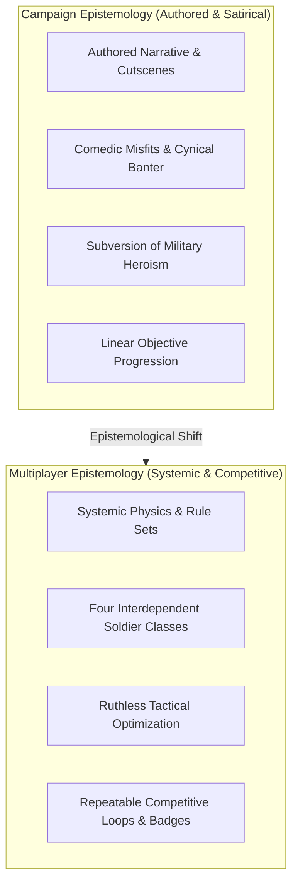
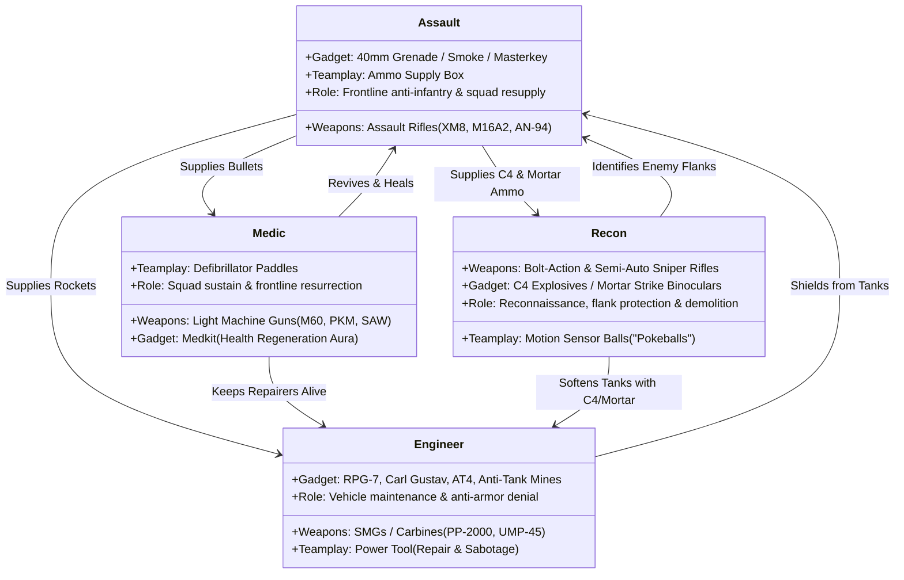

# 09. Multiplayer Systems, Combined Arms, and the Social Organization of Digital Warfare

**Project:** *Battlefield: Bad Company 2* Academic Investigation  
**Primary Analytical Domains:** Ludology, Game Design Systems, Social Media Psychology, Multiplayer Epistemologies  
**Scope:** Core Modes (Rush, Conquest, Squad Rush, Squad Deathmatch), 4-Class Architecture, Spotting, Vehicles, Social Camaraderie  

---

## 1. The Dual Identity: Campaign Satire vs. Multiplayer Competitiveness

A central structural finding of this investigation is the fundamental epistemological rift dividing the single-player campaign from the multiplayer experience in *Battlefield: Bad Company 2*.

In the single-player campaign, war is presented through an authored, comedic lens. The player is accompanied by an insubordinate squad of misfits whose bickering, cynical dialogue continually punctures the self-serious myth of military heroism. In multiplayer, however, this satirical framework vanishes entirely. There are no ironic jokes, no bickering misfits, and no narrative deconstructions of foreign policy.

Instead, multiplayer reconstitutes warfare as a ruthlessly optimized, highly cooperative, and deeply competitive systemic sport. The ideological ambiguities of the narrative are replaced by clean, unambiguous binary objectives: Attack or Defend, Capture or Lose, Kill or Be Killed.



---

## 2. Game Modes: Architecture and Spatial Pacing

*Bad Company 2* shipped on March 2, 2010 (North America) across PC, PlayStation 3, and Xbox 360, featuring four primary competitive game modes:

### A. Rush (The Signature Mode of Bad Company)
Originally created by DICE specifically for *Battlefield: Bad Company* (2008) under the name "Gold Rush," the mode was refined in *Bad Company 2* into the definitive asymmetric objective mode. 
- **Structure:** Up to 32 players (PC) or 24 players (consoles) are divided into Attackers and Defenders across sequential, gated combat sectors.
- **Objectives:** Attackers possess a finite pool of reinforcement tickets (typically 75 or 100). They must advance through 3 to 5 successive defensive bases, destroying two Military Communications stations (M-COM stations) per sector, either by arming a timed explosive charge or collapsing the building housing the unit.
- **Pacing & Spatial Dynamics:** Rush concentrates 24–32 players into narrow, highly volatile frontline clashes. Unlike open sandbox modes where combat is dispersed, Rush creates intense spatial pressure, explosive saturation, and dramatic tactical desperation: a single defuse at the final second can turn the tide of the entire match.

### B. Conquest (The Franchise Foundation)
The historical bedrock of the *Battlefield* series since *Battlefield 1942* (2002).
- **Structure:** Non-linear, symmetric territorial control. Both teams contest a series of capture points (flags, labeled A through D) distributed across a vast combined-arms map.
- **Ticket-Bleed Mechanic:** Each team begins with a set number of tickets (e.g., 250). Holding a majority of the capture points causes the enemy team’s tickets to steadily drain over time ("ticket bleed"), while enemy respawns deplete additional tickets.
- **Pacing:** Expansive, decentralized, and vehicular. Squads must coordinate logistics, armor movements, and defensive flanking maneuvers across vast distances (e.g., *Atacama Desert*, *Heavy Metal*).

### C. Squad Rush
A hyper-focused, competitive 4v4 iteration of Rush designed for tactical esports and clan scrimmages. One squad attacks while one squad defends a single M-COM station per sector with reduced reinforcement tickets. Without vehicles, the mode emphasizes individual gunplay, squad revives, and micro-destruction.

### D. Squad Deathmatch
A chaotic four-way battle where four distinct four-player squads (16 players total) compete to reach 50 kills. A single neutral infantry fighting vehicle (BMD-3) spawns in the center of the map, forcing squads to fight for mechanical armored dominance amidst total crossfire.

---

## 3. The Four-Class System and Ludic Interdependence

DICE achieved legendary mechanical balance in *Bad Company 2* by condensing the seven historical classes of *Battlefield 2* into four tightly defined, mutually dependent roles. The game mechanically penalizes lone-wolf players while providing massive point incentives for class cooperation:



### The Synergy Loop:
- The **Assault** player is the lifeblood of the team's ammunition. Without Assault resupply boxes, Engineers quickly run out of anti-tank rockets, Medics exhaust their machine-gun belts, and Recons lose their C4 charges.
- The **Medic** wields high-capacity light machine guns (notably the infamous launch-era M60) to provide suppression fire, while dropping medical crates that accelerate health regeneration. The defibrillator paddle allows instant resurrection of fallen squadmates, refunding the lost reinforcement ticket and maintaining defensive frontline cohesion.
- The **Engineer** is the sole bulwark against mechanized slaughter. Equipped with shoulder-fired rocket launchers (RPG-7, Carl Gustav) and the repair tool, the Engineer can sustain friendly tanks under fire while neutralizing hostile armor.
- The **Recon** class counters campers and ambushes by throwing spherical **Motion Sensors** (colloquially termed "pokeballs"), which reveal all moving enemy units on the squad's mini-map within a designated radius, while using mortar strikes to level fortified defensive buildings.

---

## 4. Squad Mechanics, 3D Spotting, and Combined Arms

### A. Four-Player Squads and Forward Spawning
Players are organized into four-man squads. A foundational mechanic in *Bad Company 2* is **squad spawning**: dead players can choose to respawn directly on any living squadmate who is currently out of direct combat. This creates a powerful tactical imperative to keep at least one squad member alive, fostering intense micro-communication and selfless self-preservation during intense assaults.

### B. 3D Spotting and Pötzsch’s "iWar"
By pressing the spot button (Q on PC, "Back/Select" or bumper on consoles) while aiming at an enemy soldier, vehicle, or helicopter, the player places a bright red triangular marker (colloquially termed a "red Dorito") directly above the target’s head, visible to the entire team on both the heads-up display (HUD) and the tactical mini-map for several seconds. 

Applying Holger Pötzsch’s (2015) theory of **iWar**, 3D spotting represents the ultimate digital colonization of perception. The chaotic, camouflaged visual field of the battlefield is algorithmically organized and clarified: players no longer aim at human bodies concealed in foliage, but track and shoot at floating digital iconography. Warfare is proceduralized into high-speed target acquisition.

### C. Combined-Arms Vehicular Warfare
Unlike infantry-only competitive shooters, *Bad Company 2* integrates combined-arms combat across land, sea, and air:
- **Main Battle Tanks (M1A2 Abrams, T-90):** The apex predators of ground combat. Highly lethal with 120mm high-explosive shells, but profoundly vulnerable to flanking infantry armed with C4 or synchronized RPG strikes. Tanks require dedicated Engineer escorts to survive.
- **Attack Helicopters (AH-64 Apache, Mi-28 Havoc):** High-skill, high-reward aerial platforms. In the hands of a skilled pilot and gunner operating over voice chat, the attack helicopter could dominate an entire lobby, raining 30mm explosive cannon fire and guided rockets from high altitude.
- **Tracer Dart Gun & Anti-Vehicle Counter-Play:** To balance aerial dominance, DICE implemented the **Tracer Dart Gun**. A player could fire a slow-moving, magnetic tracking dart onto a fast-moving helicopter. Once tagged, any friendly Engineer equipped with an RPG-7 or Carl Gustav could lock onto the dart from miles away, firing fire-and-forget rockets that curved through the sky to eliminate the aircraft.

---

## 5. Social Psychology of Digital Warfare: Brotherhood in the Server

In evaluating RQ5, RQ6, and RQ10, *Bad Company 2*’s multiplayer architecture reveals how digital play constructs authentic feelings of social solidarity and fraternal trust.

```mermaid
sequenceDiagram
    participant P1 as Player 1 (Tank Driver)
    participant P2 as Player 2 (Engineer Gunner)
    participant P3 as Player 3 (Combat Medic)
    participant P4 as Player 4 (Recon Spotter)

    P4->>P1: Throws Motion Sensor; Spots Enemy Tank Trap
    P1->>P2: Drives into M-COM Courtyard; Shells Choke Point
    Note over P1,P2: Hostile RPG strikes Tank (Health drops to 20%)
    P2->>P1: Jumps out; Applies Power Tool Repair under fire
    P3->>P2: Throws Smoke Grenade & Drops Medkit to protect Repairer
    Note over P2,P3: Enemy sniper kills Player 2
    P3->>P2: Defibrillator Revive! (Player 2 resurrected immediately)
    P2-->>P1: Completes Tank Repair to 100%
    P1-->>P4: Shells Building; Collapses Sniper Tower ("2.0 Hull Down")
```

The game's reward systems deliberately cultivate self-sacrifice:
- Reviving a teammate yields the same score as an enemy kill (50 points).
- Resupplying a squadmate or repairing a vehicle generates continuous, compounding experience points.
- Squad members receive dedicated "Squad Assist," "Squad Revive," and "Squad Spot" score bonuses that surpass individual action rewards.

Through these mechanics, players internalize a profound sense of mutual dependency. The emotional experience of playing *Bad Company 2* with three friends over voice communication closely mimics the sociological dynamics of military cohesion described by military sociologists: loyalty is directed not toward an abstract political state, but toward the immediate comrades responsible for keeping you alive.

However, this intense social pleasure deepens the game's central ideological contradiction. In multiplayer, the catastrophic violence of modern warfare is stripped of its tragic, geopolitical, and human reality. Armed conflict is transformed into an endlessly pleasurable, highly repeatable social team-building exercise—the ultimate triumph of militainment.

