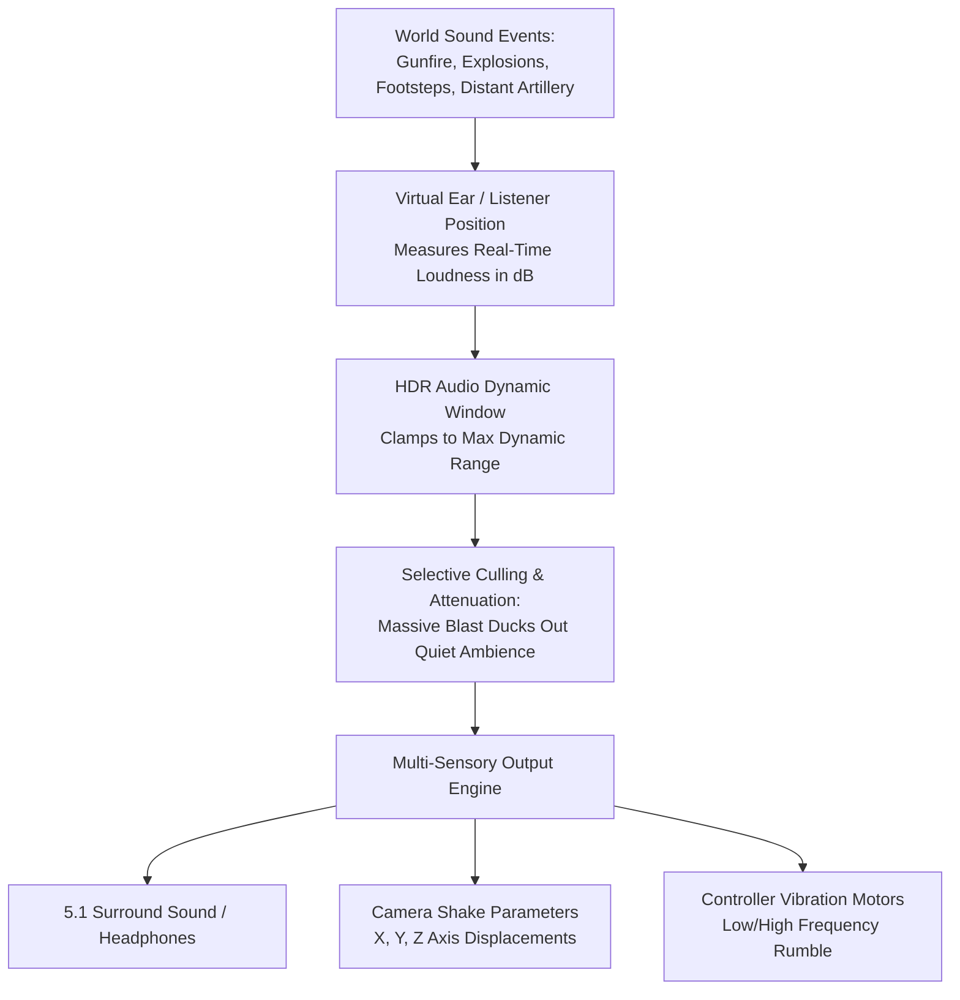
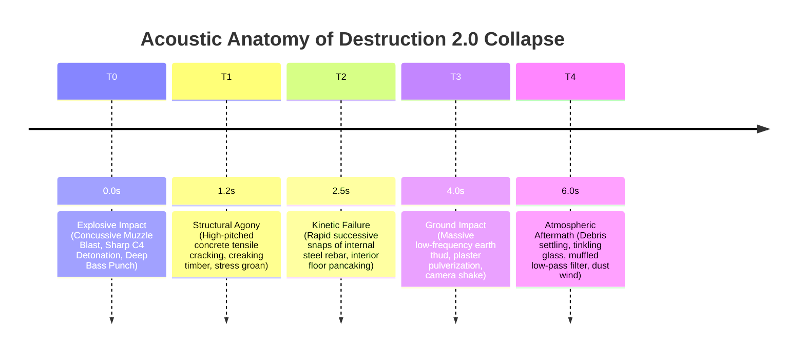

# 10. Acoustic Ecology, High Dynamic Range (HDR) Sound, and Sensorimotor Immersion

**Project:** *Battlefield: Bad Company 2* Academic Investigation  
**Primary Subject:** Audio Architecture of EA DICE (Stefan Strandberg, Audio Director)  
**Accolades:** BAFTA Award for *Use of Audio in Video Games* (2011)  
**Theoretical Frameworks:** Acoustic Ecology, The Logistics of Perception (Virilio), Sensorimotor Immersion (Grimshaw)  

---

## 1. The Sonic Revolution of Frostbite 1.5

While *Battlefield: Bad Company 2* is celebrated for its visual and physics-based destruction, its audio design represents arguably its most influential contribution to modern video game technology. Under the creative direction of Audio Director Stefan Strandberg, DICE fundamentally re-engineered how interactive sound operates within a real-time 3D simulation (Strandberg, 2010a, 2010b). 

Prior to *Bad Company 2*, mainstream first-person shooters utilized static, pre-mixed audio assets. Every weapon sound was compressed and normalized to ensure it played at a uniform volume, leading to chaotic "audio soup" during intense firefights where explosions, shouts, and gunfire collided in an undifferentiated wall of noise.

DICE broke with this paradigm by pioneering **High Dynamic Range (HDR) Audio** in the Frostbite 1.5 engine (Strandberg, 2010a). 

### The Engineering of HDR Audio
HDR Audio in Frostbite operates analogously to optical High Dynamic Range in computer graphics. Instead of compressing all sounds into a narrow dynamic range, the engine assigns an absolute real-world decibel (dB) value to every sonic event (e.g., footstep = 30 dB; rifle shot = 130 dB; tank shell explosion = 160 dB). 

The engine establishes a dynamic "auditory window" centered on the loudest sound currently reaching the virtual listener's position:
- When a low-decibel event occurs in quiet surroundings (e.g., Marlowe walking through a snowy forest), the auditory window slides downward, allowing the player to hear the subtle crunch of snow, distant bird calls, and the click of a rifle safety.
- When a massive high-decibel event occurs (e.g., an artillery shell detonates 10 meters away), the auditory window instantly surges upward. The concussive explosion dominates the soundscape, naturally "ducking" (attenuating) quieter sounds—such as distant footsteps or gentle wind—below the threshold of audibility.
- Following the blast, a simulated "temporary threshold shift" (tinnitus ringing and muffled low-pass filtering) is applied, mimicking the physiological response of the human eardrum recovering from acoustic trauma.

---

## 2. Field Recording Methodologies and Acoustic Physics

To achieve authentic weapon signatures, the DICE audio engineering team rejected synthetic synthesizer sound effects, conducting extensive live-fire recording expeditions in military training quarries, dense Scandinavian pine forests, and indoor concrete bunkers (Strandberg, 2010b).

### A. Tri-Layer Weapon Architecture
Every gunshot in *Bad Company 2* is rendered through three simultaneous, synchronized audio layers:
1. **The Mechanical Transient:** The high-frequency metallic click of the firing pin, bolt cycle, and casing ejection, recorded centimeters from the firearm.
2. **The Muzzle Blast:** The concussive, low-frequency expansion of propellant gas, delivering deep bass impact.
3. **The Environmental Tail (Reverberation):** The acoustic reflection of the shot propagating across the specific surrounding geometry. DICE recorded individual impulse responses for indoor rooms, narrow concrete alleys, open desert valleys, and dense jungle canopies. Firing an M16 inside a small bathroom sounds sharply metallic and enclosed; firing the exact same weapon in the Atacama desert produces a flat crack followed by a prolonged, rolling echo bouncing off distant mountain ridges.

### B. The Speed of Sound and Supersonic Ballistics
DICE accurately simulated the physical speed of sound in air (approximately 343 meters per second):
- When an enemy sniper fires at the player from 600 meters away, the player first hears the terrifying, supersonic **"snap-crack"** of the bullet passing centimeters from their head (as the projectile travels faster than sound).
- Only 1.5 to 2.0 seconds later does the distant, dull **"thud"** of the sniper's muzzle blast reach the player’s ears. 

This acoustic delay provides vital spatial information, allowing players to calculate the distance and bearing of hidden shooters using purely auditory cues.

---

## 3. Concussive Multi-Sensory Synchronization: Audio as Physics

A critical revelation documented in Stefan Strandberg’s (2010a) technical postmortem is that in Frostbite 1.5, **the audio engine was granted direct programmatic control over the game's visual camera-shake and controller haptic rumble**.

In standard game engines, camera shake is scripted by visual artists as an independent animation, while controller rumble is triggered by separate gameplay logic. This frequently results in microsecond desynchronizations where the visual screen shakes before the explosion sound wave peaks, breaking physical plausibility.

In *Bad Company 2*, DICE inverted this hierarchy:
> *"We let the audio engine drive the camera shake on all three axes (X, Y, and Z) as well as the controller rumble... When a blast occurs, the acoustic waveform itself dictates the exact amplitude and decay of the screen shudder and haptic motors."* (Strandberg, 2010a)

When a 120mm tank shell or C4 charge detonates near the player:
1. The low-frequency acoustic wave (20 Hz–60 Hz) hits the player's speakers or subwoofer.
2. Simultaneously, the audio engine feeds the wave's peak amplitude into the gamepad's low-frequency eccentric rotating mass (ERM) motor, delivering a heavy physical thud to the player’s hands.
3. At the exact microsecond of peak acoustic pressure, the first-person camera is violently jolted along its rotational axes, accompanied by a dynamic blur filter that simulates retinal shock.

This seamless tri-fold binding (Sound + Haptics + Visual Trauma) creates an overwhelming sensation of **concussive impact**. The explosion ceases to be a mere picture on a monitor; it becomes a physical, bodily event.

---

## 4. Destruction Acoustics: The Symphony of Collapse

The acoustic modeling of Destruction 2.0 was designed to communicate structural narrative through sound alone. When a multi-story building is brought down, the collapse unfolds as an intricate acoustic progression:

By providing clear acoustic warnings (Phase T1), DICE solved a major gameplay problem: players inside a building could hear the structure groaning under catastrophic load, giving them a three-second window of frantic panic to leap through a window before the roof collapsed upon them.

---

## 5. Dialogue Implementation and Combat Chatter

### A. Ensemble Recording vs. Isolated Booths
As highlighted in Section 6, DICE recorded Bruce DuBose (Marlowe), Keith Szarabajka (Redford), Nigel de Long (Haggard), and Anton Beablau (Sweetwater) together in an open acoustic stage (Strandberg, 2010b). The actors reacted to one another's physical gestures, interrupted lines, and engaged in genuine comedic timing.

### B. Dynamic Combat Chatter (Barks)
In multiplayer, DICE implemented a vast database of situational audio barks. Player characters automatically call out tactical developments without requiring player input:
- Spotting an enemy triggers a vocal identification: *"Sniper spotted in the second-story window!"* or *"Enemy armor moving south!"*
- Suppressive fire triggers frantic screams: *"I'm pinned down! Give me some cover!"*
- Low ammunition triggers desperate pleas: *"I'm dry! Drop some ammo!"*

Critically, these callouts were rendered in authentic languages: Russian faction soldiers spoke full native Russian (with an option for localized English with heavy accents), while American soldiers deployed authentic US Army profanity and jargon. 

Furthermore, enemy callouts are acoustically audible in 3D space: if a hidden enemy soldier reloads behind a wall, their character audibly mutters *"Reloading!"* in Russian, allowing attentive players to locate and eliminate them through the drywall.

---

## 6. The Psychological and Ideological Function of Immersion

Applying Mark Grimshaw’s (2014) concept of the **acoustic ecology of games** and Paul Virilio’s (1989) **logistics of perception**, *Bad Company 2*’s sound design achieves an unprecedented level of *sensorimotor immersion*.

Immersion in *Bad Company 2* is not primarily intellectual or narrative; it is **physiological**. The deep acoustic bass of explosions triggers an instinctual fight-or-flight adrenal response. The crisp, percussive feedback of headshot pings produces an immediate neurochemical dopamine reward.

Herein lies the ultimate paradox of the game’s sound design:
**The more acoustically realistic and sensorially thrilling the violence becomes, the more completely the player is detached from the real-world humanitarian horror of war.**

In actual armed conflict, the sound of artillery and collapsing buildings signifies maiming, death, traumatic brain injury, and civilian terror. In *Bad Company 2*, through the engineering genius of Stefan Strandberg and the HDR system, that same acoustic terror is transformed into pure aesthetic pleasure. The concussive soundscape of modern warfare is commodified into an exhilarating audio-haptic playground, cementing *Bad Company 2* as a masterwork of late-capitalist militainment.
