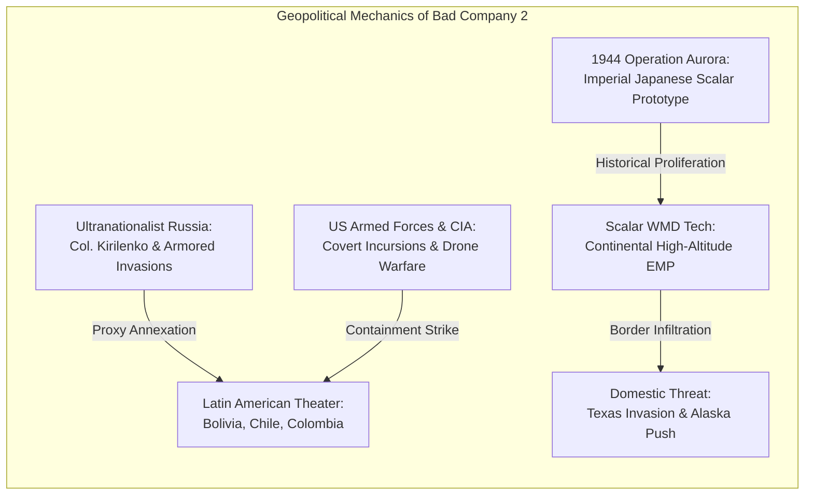
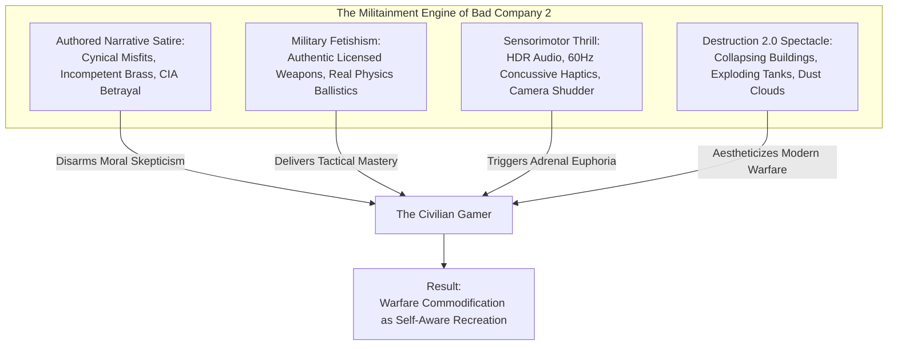

# 11. Geopolitics, Ideology, and the Spectacle of Violence: The Contradictions of Interactive Warfare

**Project:** *Battlefield: Bad Company 2* Academic Investigation  
**Primary Theoretical Lenses:** Critical Geopolitics, The Military-Industrial-Entertainment Complex, Militainment, Post-Cold War Ideology  
**Key Scholars:** Roger Stahl, Richard Godfrey, Tim Lenoir & Luke Caldwell, Marcus Schulzke, Nick Robinson, Neil Renic & Sebastian Kaempf  

---

## 1. Geopolitical Architecture: The Resurrection of the Cold War

The narrative of *Battlefield: Bad Company 2* is situated within an alternate post-Cold War geopolitical landscape. Following the fall of the Soviet Union, the geopolitical consensus in Western political science projected an era of liberal democratic hegemony and globalization (the "End of History"). 

However, *Bad Company 2* constructs a nightmare counter-scenario: a revanchist, ultranationalist Russian Federation that has mobilized its massive conventional military to wage an aggressive, multi-theater war of conquest against the United States and its global allies (Van den Heede et al., 2018; Schulzke, 2017).

### A. The Russian Threat as Structural Convenience
Why did DICE shift from the whimsical, non-ideological gold hunt in a fictional Middle Eastern nation (*Serdaristan*) in the 2008 original to a massive, conventional US-Russia world war in *Bad Company 2*? 

As documented by Patrick Bach (2010), DICE sought higher narrative stakes to match the expanding scale of Frostbite’s destruction technology. However, when examined through political communication theory, the selection of Russia as the primary adversary performs vital ideological work:
1. **Moral Legitimization of Industrial Violence:** Fighting insurgent cells or non-state guerrilla factions in asymmetrical conflicts (such as Iraq or Afghanistan) introduces thorny ethical and political complexities regarding counter-insurgency, civilian casualties, and neo-colonialism. A conventional Russian military threat, complete with T-90 tanks, Hind gunships, and uniform-clad Spetsnaz, provides a clean, peer-state adversary against whom total kinetic devastation is politically and morally uncomplicated.
2. **Cold War Nostalgia:** For Western audiences, the Soviet/Russian military apparatus represents a deeply familiar cultural archetype. It reactivates decades of Cold War cinema, thrillers, and video games (*Red Dawn*, *GoldenEye*, *Modern Warfare*), allowing players to intuitively understand their role without requiring complex geopolitical exposition.

---

## 2. The Global South as an Ungoverned Tactical Sandbox

A striking, yet frequently overlooked, dimension of *Bad Company 2*'s geopolitical representation is its setting: the vast majority of the campaign (Missions 2 through 10) takes place across South America—specifically Bolivia, Chile, and Colombia.

### A. Porous Sovereignty and Latin American Geography
In *Bad Company 2*, the sovereign states of Latin America are depicted as passive, ungoverned operational vacuums. There are no functioning Latin American governments, municipal police forces, or legal authorities visible anywhere in the game. 

Bolivia is reduced to dense jungle rivers and fortified drug/mercenary outposts; the Atacama Desert in Chile is framed as an empty wasteland of rusting ships and military bases; and Colombia is depicted as a nighttime industrial port controlled by paramilitaries. 

Applying Marcus Schulzke’s (2017) and Tanner Mirrlees’ (2016) critiques of military video game geographies, the Global South functions purely as a **terra nullius**—an un-sovereign playground where Western special forces and Russian invaders can wage unrestricted combined-arms warfare, demolish local architecture, and settle global supremacy disputes without consulting local populations or adhering to international treaties.

### B. The Absolute Erasure of Civilian Life
As highlighted in Section 8 via Renic and Kaempf (2022), the civilian population of South America is entirely expunged from the virtual world. When the player levels an entire Chilean village with tank shells in Mission 6 (*Heavy Metal*), the homes are completely empty of families, children, and personal belongings. 

This absolute erasure sanitizes the reality of military intervention. By deleting civilians, the game ensures that the player never experiences the guilt of causing collateral damage, naturalizing the imperial assumption that foreign territories exist solely as tactical terrain for superpower combat.

---

## 3. The Scalar Superweapon: Technopolitics and EMP Anxiety

At the center of *Bad Company 2*’s plot lies the **Scalar Weapon**—a fictional electromagnetic superweapon developed by Imperial Japan in World War II, resurrected by Russian ultranationalists, and designed to detonate in the upper atmosphere over North America, delivering a continent-wide electromagnetic pulse (EMP).

### A. The Weapon as Technophobic MacGuffin
In modern military thrillers, weapons of mass destruction (WMDs) rarely function as realistic military hardware; rather, they operate as **technological symbols of existential vulnerability** (Salter, 2011; Der Derian, 2009). The scalar weapon tapers into deep-seated Western anxieties regarding technological dependence. An EMP does not poison populations with biological pathogens or incinerate cities with nuclear fire; it disables **the electrical and digital grid**. It threatens late-capitalist society at its most vulnerable node: communications, finance, transportation, and power.

### B. Preemption and the "Virtuous" Incursion
The threat of the scalar weapon provides retrospective ethical justification for all of Bad Company's unauthorized, illegal actions. In the campaign, B-Company repeatedly violates international borders, defies sovereign airspace, executes extrajudicial assassinations, and rejects official orders from the US Army hierarchy. 

However, because Kirilenko possesses a device capable of shutting down the entire United States, the game’s narrative proceduralizes the doctrine of **preemptive strike** (Der Derian, 2009; Schulzke, 2017): when the existential survival of the homeland is at stake, all international laws, sovereign borders, and ethical restraints become irrelevant.

---

## 4. Militainment and the Commodification of Violence

In evaluating the paper’s central question—**Can a game meaningfully critique military-shooter conventions while deriving its core pleasure from the spectacle of violence?**—we must synthesize the insights of Roger Stahl (2009), Richard Godfrey (2022), and Tim Lenoir and Luke Caldwell (2018).

### A. The Disarming Power of Ironic Distance
The core ideological achievement of *Bad Company 2* is its deployment of **ironic distance** (Robinson, 2012, 2015). Traditional, earnest military propaganda (such as *America’s Army* or early *Medal of Honor*) demands that the player believe in the moral purity of the nation-state and the noble sacrifice of the soldier. In contemporary cynical culture, this earnestness triggers immediate cognitive resistance from critical players.

*Bad Company 2* sidesteps this resistance by adopting the player’s own cynicism. The game agrees with the player that government bureaucrats are liars, that the CIA is corrupt (Agent Aguire), that military commanders are incompetent, and that dying for a flag is a sucker’s game. 

By mocking institutional authority, the game establishes a false sense of subversive rebellion. The player feels that they are participating in an anti-establishment critique. Yet this rebellion is strictly superficial: it operates within a closed commercial product designed to celebrate the kinetic hardware, explosive violence, and tactical dominance of the Western war machine.

### B. The Spectacle of Destruction as Late-Capitalist Commodity
Richard Godfrey (2022) notes that contemporary war games commodify the "spectacle of violence," transforming real-world state terror into a consumer good. In *Bad Company 2*, destruction is not depicted as an atrocity that displaces populations, creates generational trauma, and shatters societies; it is marketed as a **breakthrough graphics and physics feature**.

The player does not weep when a building collapses; they marvel at the particle shaders, admire the volumetric smoke rendering, and listen to the crisp low-frequency rumble of their subwoofer. The physical ruin of the human world is transformed into a playground of interactive beauty.

---

## 5. Synthesis: The Unavoidable Contradiction of Interactive War

Ultimately, *Battlefield: Bad Company 2* cannot escape its foundational contradiction. 

To function as a successful commercial blockbuster in the AAA video game market, the game *must* deliver exhilarating, responsive, and tactile military violence. It must make shooting an assault rifle feel empowering, it must make driving a tank feel unstoppable, and it must make blowing up a building feel like an ecstatic victory.

David Goldfarb and DICE’s comedic writing succeeds brilliantly at "taking the piss out of" the pompous cinematic clichés of *Call of Duty*. It creates an unforgettable, lovable ensemble of working-class soldiers whose fraternal loyalty provides genuine emotional warmth. 

Yet this very comedic brilliance serves to entrench, rather than dismantle, the logic of militainment. By wrapping the brutal mechanics of high-tech imperial warfare in laughter, irreverence, and self-aware irony, *Battlefield: Bad Company 2* does not subvert the military-entertainment complex—it creates its most seductive, pleasurable, and ideologically resilient manifestation.

